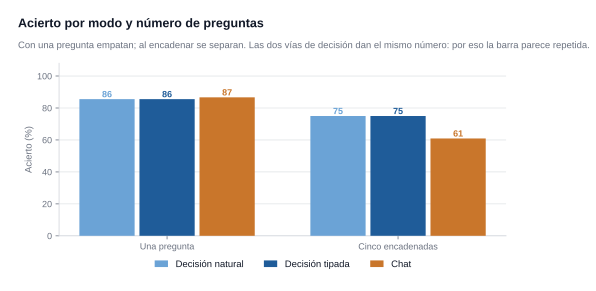
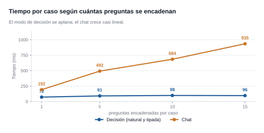

# AIOM — un modelo, dos formas de preguntar

**La idea, en una frase:** un modelo de decisión como Jev no es un modelo distinto de
un LLM. **Es el mismo.** Lo que cambia es **cómo le haces la pregunta** y **qué le pides
de vuelta**: prosa, o un valor de un conjunto cerrado con sus probabilidades.

Este repositorio demuestra que eso se consigue con **un modelo corriente en tu propio
equipo**, sin entrenar nada y sin cargar un segundo modelo.

## Cómo funciona


La pieza que lo hace posible no es el modelo: es **el endpoint**. llama.cpp de serie
solo sabe generar texto; el backend
[`parallel-decision`](https://github.com/thecodacus/llama.cpp/tree/parallel-decision)
añade uno que **puntúa las opciones en lugar de redactar**. Por eso el modo de decisión
no gasta tokens: no es que escriba poco, es que **no pasa por el bucle de generación**.

**El cliente tiene dos puertas y las dos acaban en el mismo sitio.** Por consola
(`preguntar.py`, que habla con el servidor el solo) o por HTTP, contra `api.py` —la API,
que además sirve la interfaz web en el mismo proceso—. Y a la API también se la puede
llamar **sin cliente ninguno**: con `curl` o Postman. El modo —decisión o chat— no es del
sistema: es **una propiedad de la petición**, y por eso se pueden pedir los dos a la vez y
compararlos.

## Empezar

Dos pasos: **levantar el servidor** y **preguntar**. El servidor es un `llama-server`
con el backend de decisión; el resto es este repositorio.

```bash
# 1. el servidor (una terminal aparte; tarda en cargar el modelo)
llama-server -m modelo.gguf -ngl 99 -fa on -c 32768 --decision-seqs 64 --port 8096

# 2. preguntar (desde la carpeta del repositorio)
python preguntar.py ejemplos/1_opciones.txt
```

`--decision-seqs` **no es opcional**: sin él el endpoint de decisión no existe.

**[→ Cómo levantar el servidor paso a paso, y qué hacer si falla](docs/ARRANCAR.md)**

No hace falta instalar nada para usar el cliente: **solo la biblioteca estándar de
Python 3.10+**. El detalle de cómo se construyó y compiló el backend está en
[`CREDITOS.md`](CREDITOS.md).

## Las dos formas de preguntar (y el respaldo)

|  | cómo se escribe | quién puede escribirlo |
|---|---|---|
| **lenguaje natural** | `ask: ...` + `choice:` | cualquiera |
| **tipada** | JSON con `questions.decision` y `criteria` | quien conozca el esquema |

**Dan exactamente lo mismo.** Medido sobre 90 casos: **85,6% de acierto y 76 ms en las
dos**, con idéntica confianza. El formato tipado no aporta nada aquí y sí cuesta, así
que la puerta de entrada es el lenguaje natural.

```
input: Buenos días. Llevo desde ayer sin poder entrar a la aplicación: me sale un
error 500 cada vez que intento iniciar sesión.

ask: ¿A qué área hay que enviar este correo?
choice:
  soporte: Fallos y errores del producto
  facturacion: Cobros, facturas y reembolsos
  comercial: Ventas y planes
  otros: Todo lo demás
```

La cabecera decide el tipo de pregunta:

| cabecera que escribes | tipo | devuelve |
|---|---|---|
| `choice:` | **choice** | la opción elegida + probabilidad de todas + confianza |
| `score:` | **score** | posición en la escala (puede caer entre dos niveles) |
| `noul:` | **noul** | un valor entre 0 y 1 |

Si la pregunta **no cabe** en ningún campo conocido, se releva al modo chat sobre el
**mismo** modelo. Una sola pasada decide las dos cosas: si era respondible, y cuáles
son los valores.

```bash
python preguntar.py ejemplos/1_opciones.txt        # elegir de una lista
python preguntar.py ejemplos/2_niveles.txt         # poner algo en una escala
python preguntar.py ejemplos/3_booleano.txt        # un sí o un no
python preguntar.py ejemplos/4_tres_preguntas.txt  # las tres de golpe
python preguntar.py ejemplos/5_correo_soporte.txt  # un correo real, con las tres
```

Los cinco están explicados paso a paso, con su salida real, en
[`docs/MANUAL.md`](docs/MANUAL.md).

## Lo que se gana, medido aquí

**Una pregunta suelta** (90 casos, 30 de cada tipo):

| modo | acierto | p50 | confianza |
|---|---|---|---|
| decisión, natural | 85,6% | **76 ms** | 0,82 |
| decisión, tipada | 85,6% | 76 ms | 0,82 |
| chat | 86,7% | 111 ms | — |

Con una pregunta **los tres aciertan igual**. Lo que cambia no es acertar más: es lo que
cuesta. **Un 31% menos de tiempo y sin escribir ni un token.**

**Con varias preguntas encadenadas** (14 casos, 64 preguntas) la brecha se abre:

| modo | acierto | p50 | respuestas ilegibles |
|---|---|---|---|
| decisión | **75,0%** | **93 ms** | 0 |
| chat | 60,9% | 340 ms | **8** |



Y **cuantas más preguntas, mejor sale** el modo de decisión. Con un fondo de 15
preguntas por caso, tomando las primeras N:

| preguntas encadenadas | decisión | chat | ventaja |
|---|---|---|---|
| 1 | 72 ms | 192 ms | 2.7× |
| 5 | 91 ms | 492 ms | 5.4× |
| 10 | 98 ms | 684 ms | 7.0× |
| 15 | **96 ms** | **935 ms** | **9.8×** |



De 1 a 15 preguntas el modo de decisión sube un **33%**; el chat, un **387%**. El motor
puntúa todas las preguntas **en la misma pasada**, así que añadir una casi no cuesta
nada. Ese es el hallazgo práctico: **cuantas más preguntas por caso, mejor sale el modo
de decisión.**

## Dos cosas que conviene leer antes de tocar el modelo

**El fallo puede ser de la pregunta, no del modelo.** Dos casos fallaban en modo
decisión y el **mismo modelo los acierta cuando se le quita la descripción del campo**
(el idioma del texto: empate a tres con la etiqueta, 0,69 sin ella; la forma de una
fruta: «redonda» 0,64 con etiqueta, «alargada» 0,67 sin ella). Añadir
`'etiqueta' = descripción` a la pregunta **diluye la pregunta**. Un RAG habría empeorado
esos casos: al modelo le sobraba ruido, no le faltaba información.

**Un rango ancho es una trampa.** Un campo numérico de 1 a 99 hacía que acertara 3 de 5
y que la confianza cayera a 0,57. Acotado a 1–12: **5 de 5 y confianza 1,000.** Con 99
valores el modelo debe puntuar muchos nodos y la probabilidad se reparte.

Los dos están medidos y desglosados, con la tabla completa, en
[`docs/ESTUDIO.md`](docs/ESTUDIO.md).

## Lo que este repositorio NO es

- **No compara con Jev ni con ningún modelo del mercado.** Son los resultados medidos
  aquí, con este equipo y este modelo.
- **No reivindica el motor.** El endpoint es de terceros; lo propio es el cliente, el
  traductor de lenguaje natural, la técnica de los dos modos sobre un solo modelo y las
  mediciones. Está todo desglosado, con autoría y licencia de cada pieza, en
  [`CREDITOS.md`](CREDITOS.md).
- **No es un modelo entrenado.** No hay ajuste fino en ninguna parte.

## Probarlo

```bash
# 1. el servidor, con el endpoint de decisión activado
llama-server -m modelo.gguf -ngl 99 -fa on -c 32768 --decision-seqs 64 --port 8096

# 2. preguntar en lenguaje natural y recibir solo el valor
python preguntar.py ejemplos/1_opciones.txt

# 3. medirlo tú mismo y comprobar que los documentos cuadran con los datos
python bench_modos.py && python rendimiento.py && python verificar.py --estricto
```

## Desde el navegador, y desde un programa

Con el servidor arriba, `api.py` levanta la API y **sirve también la interfaz** — así
no hay un segundo servidor ni un paso de compilación:

```bash
python api.py          # y abre http://127.0.0.1:8100/
```

La interfaz deja escribir el caso y las preguntas **una sola vez**, de tres formas
distintas —**por bloques**, en **lenguaje natural** o en **JSON tipado**— que son tres
vistas de lo mismo: se cambia de pestaña y lo escrito aparece en la otra forma. Con
«Comparar» activado pregunta lo mismo por las dos vías y las pone lado a lado: qué
responde cada modo y cuánto tarda cada uno.

**Y el caso no hace falta escribirlo**: se carga un documento (pdf, docx, txt, md, csv)
y las preguntas van sobre él. Un `.docx` se lee sin instalar nada; un `.pdf` pide
`pip install pymupdf`. Lo mismo desde la línea de comandos:

```bash
python preguntar.py mis_preguntas.txt --documento carta.pdf
```

Lo mismo desde un programa, declarando el formato (no se adivina):

```bash
curl -X POST localhost:8100/ask -H "Content-Type: application/json" \
  -d '{"formato":"natural","entrada":"input: ... ask: ... choice: ...","comparar":true}'
```

`formato` es `texto`, `natural` o `tipado`. Detalles en [docs/API.md](docs/API.md).

## Documentación

| documento | qué hay |
|---|---|
| **[docs/MANUAL.md](docs/MANUAL.md)** | **empieza aquí**: el manual de uso, de cero, con un ejemplo de cada tipo (opciones, niveles, sí/no), cómo se hacen varias preguntas a la vez y cómo se escribe en formato tipado |
| **[docs/ARRANCAR.md](docs/ARRANCAR.md)** | **la ruta completa, de cero**: el modelo, compilar el servidor, arrancarlo, y las dos puertas para preguntar. Con qué hacer si algo no arranca |
| [docs/CLIENTE.md](docs/CLIENTE.md) | la interfaz web: cómo se despliega, los tres modos, el documento como caso, la comparación por pregunta y cómo se lee una respuesta |
| [docs/API.md](docs/API.md) | la API HTTP: cómo se despliega y cómo se consume, los tres formatos de entrada, el documento como caso, qué devuelve y cómo probarla con `curl` |
| [DESIGN.md](DESIGN.md) | el sistema visual de la interfaz, con sus tokens, sus reglas y sus prohibiciones. Los nombres de los tokens son los mismos que los de las variables CSS, así que se puede comprobar contra el código |
| [PRODUCT.md](PRODUCT.md) | la verdad del producto: quién lo usa, qué hace, qué no se puede inventar |
| [CREDITOS.md](CREDITOS.md) | **de quién es cada pieza**, con commit exacto, licencias y el SHA256 del modelo |
| [docs/ESTUDIO.md](docs/ESTUDIO.md) | el estudio: con qué hardware se midió, cómo se construyó, los resultados completos, las lecciones y los límites |
| [docs/DETALLE.md](docs/DETALLE.md) | las 154 preguntas una por una: opciones, qué se esperaba, qué eligió cada modo y el reparto de probabilidad |
| [docs/METRICAS.md](docs/METRICAS.md) | todas las métricas consolidadas, con sus definiciones |
| [docs/ESTADO-DEL-ARTE.md](docs/ESTADO-DEL-ARTE.md) | de dónde sale la idea, quién es quién y qué es de cada uno |

## Estructura

**Lo que se usa** (esto es todo lo que hace falta para preguntar):

```
preguntar.py         LA PUERTA DE ENTRADA: escribes en lenguaje natural y deduce el
                     tipo por la cabecera; una o varias preguntas en una petición
                     (--documento hace que el caso salga de un pdf, docx, txt...)
documento.py         saca el texto de un documento para usarlo como caso
aiom.py              el motor: los tres modos, y las dos vías del servidor
api.py               la API HTTP, que además sirve la interfaz web
web/index.html       la interfaz: un solo fichero, HTML+CSS+JS sin dependencias
catalogs/            dos catálogos listos para usar:
                       iot.json      operación de campo (el que se usa por defecto)
                       soporte.json  triage de tickets, con los mismos ejemplos que
                                     publica TypeSafe, para comparar respuesta a respuesta
                     se elige con la variable AIOM_CATALOG o el argumento del script
ejemplos/            siete casos: cinco sobre correos de soporte (uno por tipo de
                     pregunta, y uno con las tres de golpe) y dos con SOLO las
                     preguntas, para usarlos con un documento:
                       6_preguntas_sobre_un_documento.txt  tres preguntas
                       7_preguntas_curriculum.txt          doce, para medir velocidad
```

**Lo que produjo los resultados** — no hace falta para usar el proyecto; está aquí
porque los números de la documentación salen de ahí y cualquiera puede auditarlos:

```
# benchmarks (escriben en results/)
bench_modos.py       90 casos, 3 modos      bench_multi.py    preguntas encadenadas
bench_cascada.py     escalado 1/5/10/15     bench.py          caudal vs concurrencia
bench_s1mb.py        benchmark público S1MB  s1mb_official.py su puntuación oficial
calibrate.py         temperature scaling     snapshot.py      métricas internas

# los conjuntos de casos con verdad de referencia
casos_modos.py  casos_multi.py  casos_cascada.py  dataset.py  dataset_stress.py

# generadores de los documentos y los gráficos
rendimiento.py -> ESTUDIO.md   detalle.py -> DETALLE.md   reports.py -> METRICAS.md
entorno.py  graficos.py  razones.py  diagrama.py  metrics.py  verificar.py
```

`results/` guarda lo medido (json) y los gráficos: **es la evidencia de cada cifra** que
aparece en los documentos.

## Los números que verás

Los resultados del estudio —tiempos, acierto, confianza— están en
[`docs/ESTUDIO.md`](docs/ESTUDIO.md), [`docs/METRICAS.md`](docs/METRICAS.md) y
[`docs/DETALLE.md`](docs/DETALLE.md). **Son informativos**: describen lo que dio este
montaje en esta máquina, no son un requisito para usar los modos.

Si quieres repetirlos tú, los scripts están arriba y `verificar.py` comprueba que las
tablas sigan cuadrando con `results/`. Hace falta el servidor levantado.

> **Si los repites:** el terminal de esta máquina lanza cada comando **dos veces**, así
> que dos benchmarks pueden correr a la vez y contaminarse los tiempos.
> `bench_cascada.py` lo evita con un candado atómico (`.cascada.lock`).

## Requisitos

- Python 3.10+ — el cliente **no tiene dependencias**, solo la biblioteca estándar.
- Un `llama-server` con el endpoint `/v1/decision`, del backend
  [`parallel-decision`](https://github.com/thecodacus/llama.cpp/tree/parallel-decision).
- Solo para **regenerar los gráficos** hace falta `matplotlib` (ver `requirements.txt`);
  sin él, `rendimiento.py` reutiliza los SVG ya generados y avisa.
- Solo para **levantar el servidor** hace falta compilar el fork de llama.cpp (Vulkan),
  con las instrucciones de [`docs/ARRANCAR.md`](docs/ARRANCAR.md).
