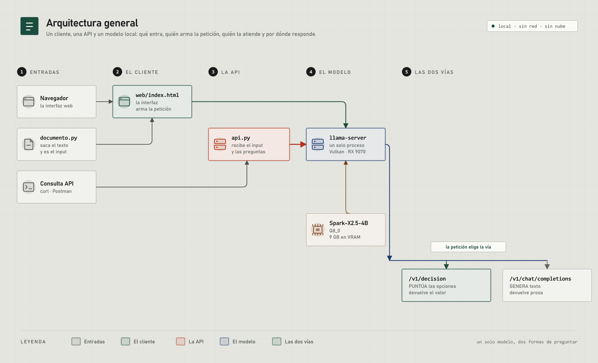

# AIOM — un modelo, dos formas de preguntar

**La idea, en una frase:** un modelo de decisión como Jev no es un modelo distinto de un
LLM. **Es el mismo.** Lo que cambia es **cómo le haces la pregunta** y **qué le pides de
vuelta**: prosa, o un valor de un conjunto cerrado con sus probabilidades.

Este repositorio demuestra que eso se consigue con **un modelo corriente en tu propio
equipo**, sin entrenar nada y sin cargar un segundo modelo.

Es un proyecto **exploratorio**: la gracia no está en un modelo nuevo, sino en entender
qué hace un LLM por dentro y hasta dónde llega cambiando solo el planteamiento —la
entrada y lo que se espera de la salida—. Nada que ajustar, nada que reentrenar, nada que
descargar de más.

## Cómo funciona



La pieza que lo hace posible no es el modelo: es **el endpoint**. llama.cpp de serie solo
sabe generar texto; el backend
[`parallel-decision`](https://github.com/thecodacus/llama.cpp/tree/parallel-decision)
añade uno que **puntúa las opciones en lugar de redactar**. Por eso el modo de decisión
no gasta tokens: no es que escriba poco, es que **no pasa por el bucle de generación**.

**El cliente tiene dos puertas y las dos acaban en el mismo sitio.** Por consola
(`preguntar.py`, que habla con el servidor el solo) o por HTTP, contra `api.py` —la API,
que además sirve la interfaz web en el mismo proceso—. Y a la API también se la puede
llamar **sin cliente ninguno**: con `curl` o Postman. El modo —decisión o chat— no es del
sistema: es **una propiedad de la petición**, y por eso se pueden pedir los dos a la vez y
compararlos.

## Empezar

Dos pasos: **levantar el servidor** y **preguntar**. El servidor es un `llama-server` con
el backend de decisión; el resto es este repositorio.

```bash
# 1. el servidor (una terminal aparte; tarda en cargar el modelo)
llama-server -m modelo.gguf -ngl 99 -fa on -c 32768 --decision-seqs 64 --port 8096

# 2. preguntar (desde la carpeta del repositorio)
python preguntar.py ejemplos/1_opciones.txt
```

`--decision-seqs` **no es opcional**: sin él el endpoint de decisión no existe.

**[→ Cómo montarlo todo paso a paso, de cero, y qué hacer si falla](docs/ARRANCAR.md)**

Para preguntar por consola **no hace falta instalar nada**: la consola, el tipado y el
motor son solo biblioteca estándar. **La API sí** —es FastAPI—, y con ella su interfaz.
De dónde sale cada pieza está en [`CREDITOS.md`](CREDITOS.md).

## Las dos formas de preguntar

**Lenguaje natural**, que es la puerta de entrada:

```
input: Buenos días. Llevo desde ayer sin poder entrar a la aplicación: me sale un
error 500 cada vez que intento iniciar sesión.

ask: ¿A qué área hay que enviar este correo?
choice:
  soporte: Fallos y errores del producto
  facturacion: Cobros, facturas y reembolsos
  comercial: Ventas y planes
  otros: Todo lo demás
```

La cabecera decide el tipo de pregunta:

| cabecera que escribes | tipo | devuelve |
|---|---|---|
| `choice:` | **choice** | la opción elegida + probabilidad de todas + confianza |
| `score:` | **score** | posición en la escala (puede caer entre dos niveles) |
| `noul:` | **noul** | un valor entre 0 y 1 |

**Tipada**, el mismo caso con el esquema explícito —es el formato de TypeSafe, traducido
tal cual—. Las dos dan exactamente lo mismo; el traductor está en `tipado.py`, y su tabla
de equivalencias está en su cabecera.

Si la pregunta **no cabe** en ningún campo conocido, se releva al modo chat sobre el
**mismo** modelo. Una sola pasada decide las dos cosas: si era respondible, y cuáles son
los valores.

```bash
python preguntar.py ejemplos/1_opciones.txt        # elegir de una lista
python preguntar.py ejemplos/2_niveles.txt         # poner algo en una escala
python preguntar.py ejemplos/3_booleano.txt        # un sí o un no
python preguntar.py ejemplos/4_tres_preguntas.txt  # las tres de golpe
python preguntar.py ejemplos/5_correo_soporte.txt  # un correo real, con las tres
```

Los cinco están explicados paso a paso, con su salida real, en
[`docs/MANUAL.md`](docs/MANUAL.md).

## La comparación: decisión contra chat

**Esto es lo único que merece la pena medir aquí**, y se mide en vivo, con tus propias
preguntas: qué responde cada vía y cuánto tarda cada una.

```bash
# por la API, con las dos vías en la misma corrida
curl -X POST localhost:8100/ask -H "Content-Type: application/json" \
  -d '{"formato":"natural","entrada":"input: ... ask: ... choice: ...","comparar":true}'
```

O en la interfaz web, con «Comparar» activado: pregunta lo mismo por las dos vías y las
pone **lado a lado, pregunta por pregunta**, para no perderse en el scroll.

La diferencia no es de acierto, es de **trabajo**: la vía de decisión **puntúa** las
opciones y devuelve un valor; la de chat **escribe** prosa que hay que interpretar. Con
una pregunta el ahorro es pequeño; con varias encadenadas se abre, porque el motor puntúa
todas **en la misma pasada** y añadir una casi no cuesta. Ese es el hallazgo práctico.

## Dos cosas que conviene saber antes de escribir tus preguntas

**El fallo puede ser de la pregunta, no del modelo.** Si añades `'etiqueta' = descripción`
a cada opción, **diluyes la pregunta**: el modelo reparte su atención entre el enunciado y
las etiquetas. Hay casos que fallan *con* la descripción y acierta *sin* ella. Si un caso
se resiste, prueba a quitarle texto, no a añadírselo.

**Y no le pongas ejemplos.** Suena a que debería ayudar —consultas de ejemplo que le
enseñen dónde está la frontera— y está medido que no: con ejemplos largos el criterio de
«¿es respondible?» **empeora** (3 de 5 casos dejan de reconocerse como contestables), y con
ejemplos cortos queda igual que sin ellos. Es lo mismo que arriba: el texto de más diluye.

**Un rango ancho es una trampa.** Un campo numérico con muchos valores posibles obliga al
modelo a puntuar muchos nodos y la probabilidad se reparte: la confianza se cae y el
valor sale mal. Acótalo al rango real.

## Lo que este repositorio NO es

- **No compara con Jev ni con ningún modelo del mercado.** Aquí solo se compara este
  modelo consigo mismo, por las dos vías.
- **No reivindica el motor.** El endpoint es de terceros; lo propio es el cliente, el
  traductor de lenguaje natural, la técnica de los dos modos sobre un solo modelo y la
  comparación en vivo. Está desglosado, con autoría y licencia de cada pieza, en
  [`CREDITOS.md`](CREDITOS.md).
- **No es un modelo entrenado.** No hay ajuste fino en ninguna parte.

## Desde el navegador, y desde un programa

Con el servidor arriba, `api.py` levanta la API y **sirve también la interfaz** — así no
hay un segundo servidor ni un paso de compilación:

```bash
python api.py          # y abre http://127.0.0.1:8100/
```

La interfaz deja escribir el caso y las preguntas **una sola vez**, de tres formas
distintas —**por bloques**, en **lenguaje natural** o en **JSON tipado**— que son tres
vistas de lo mismo: se cambia de pestaña y lo escrito aparece en la otra forma.

**Y el caso no hace falta escribirlo**: se carga un documento (pdf, docx, txt, md, csv) y
las preguntas van sobre él. Un `.docx` se lee sin instalar nada; un `.pdf` pide
`pip install pymupdf`. Lo mismo desde la línea de comandos:

```bash
python preguntar.py mis_preguntas.txt --documento carta.pdf
```

`formato` es `texto`, `natural` o `tipado` —se declara, no se adivina—. Detalles en
[docs/API.md](docs/API.md).

## Documentación

| documento | qué hay |
|---|---|
| **[docs/ARRANCAR.md](docs/ARRANCAR.md)** | **la ruta completa, de cero**: el modelo, compilar el servidor, arrancarlo, y las dos puertas para preguntar. Con qué hacer si algo no arranca |
| [docs/MANUAL.md](docs/MANUAL.md) | el manual de uso, con un ejemplo de cada tipo (opciones, niveles, sí/no), cómo se hacen varias preguntas a la vez y cómo se escribe en formato tipado |
| [docs/CLIENTE.md](docs/CLIENTE.md) | la interfaz web: cómo se despliega, los tres modos, el documento como caso, la comparación por pregunta y cómo se lee una respuesta |
| [docs/API.md](docs/API.md) | la API HTTP: cómo se despliega y cómo se consume, los tres formatos de entrada, el documento como caso, qué devuelve y cómo probarla con `curl` |
| [PRODUCT.md](PRODUCT.md) | la verdad del producto: quién lo usa, qué hace, qué no se puede inventar |
| [DESIGN.md](DESIGN.md) | el sistema visual de la interfaz, con sus tokens, sus reglas y sus prohibiciones. Los nombres de los tokens son los mismos que los de las variables CSS, así que se puede comprobar contra el código |
| [CREDITOS.md](CREDITOS.md) | **de quién es cada pieza**, con commit exacto, licencias y el SHA256 del modelo |

## Estructura

Esto es todo el proyecto. No hay nada más:

```
preguntar.py         LA PUERTA DE ENTRADA: escribes en lenguaje natural y deduce el
                     tipo por la cabecera; una o varias preguntas en una petición
                     (--documento hace que el caso salga de un pdf, docx, txt...)
aiom.py              el motor: los tres modos, y las dos vías del servidor
tipado.py            el traductor del formato tipado (el de TypeSafe, tal cual)
documento.py         saca el texto de un documento para usarlo como caso
api.py               la API HTTP (FastAPI), que además sirve la interfaz web
web/index.html       la interfaz: un solo fichero, HTML+CSS+JS sin dependencias
catalogs/            dos juegos de campos de ejemplo para el modo decisión, los que usa
                     el formato `texto` de la API:
                       iot.json      operación de campo (el que se usa por defecto)
                       soporte.json  triage de tickets
                     se elige con la variable AIOM_CATALOG o el argumento del script
ejemplos/            siete casos: cinco sobre correos de soporte (uno por tipo de
                     pregunta, y uno con las tres de golpe) y dos con SOLO las
                     preguntas, para usarlos con un documento
diagrama.py          dibuja el diagrama de arquitectura de arriba (SVG, sin librerías)
verificar.py         comprueba que los módulos importen y que los enlaces cuadren
```

## Requisitos

- Python 3.10+ — la consola, el tipado y el motor **no tienen dependencias**: solo la
  biblioteca estándar.
- Para la **API**: `pip install fastapi "uvicorn[standard]"`. Es lo único que no es
  biblioteca estándar, y es de la API, no del proyecto.
- Un `llama-server` con el endpoint `/v1/decision`, del backend
  [`parallel-decision`](https://github.com/thecodacus/llama.cpp/tree/parallel-decision).
- Para leer **PDF** como caso, `pip install pymupdf` (un `.docx` o un `.txt` no piden nada).
- Para **levantar el servidor** hay que compilar el fork de llama.cpp (Vulkan), con las
  instrucciones de [`docs/ARRANCAR.md`](docs/ARRANCAR.md).
