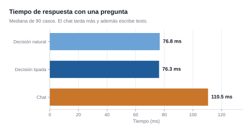
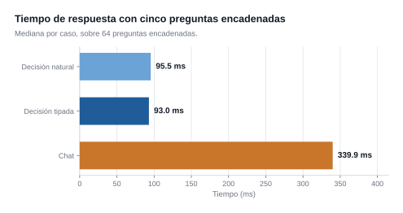
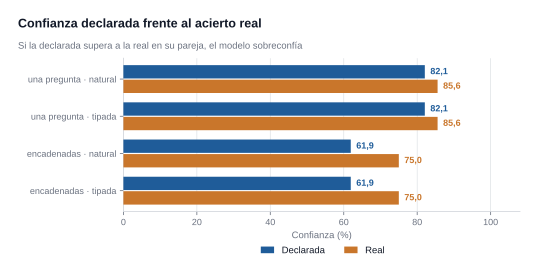

# Estudio técnico: un modelo, dos formas de preguntar

**154 preguntas con verdad de referencia, sobre un solo modelo local, en un equipo doméstico.**

Este es el documento técnico del repositorio: **con qué se midió, cómo se construyó, qué salió y dónde están los límites.** Para la idea de fondo y los resultados en corto, el [README](../README.md).

---

## Resumen

Se comparan dos formas de interrogar a **el mismo modelo local** (Spark-X2.5-4B, cuantización Q8_0) sobre **154 preguntas** con verdad de referencia: pedirle una **decisión tipada** —elegir un valor de un conjunto cerrado, sin generar texto— frente a pedirle lo mismo **por chat**, que es el uso por defecto de cualquier LLM.

**El modo de decisión responde un 31% más rápido** en preguntas
sueltas (76 ms frente a 111 ms, **1.4×**) y un **73% más rápido** cuando se encadenan cinco
preguntas sobre el mismo caso (93 ms frente a 340 ms, **3.7×**).

La razón de fondo no es que escriba menos: **no escribe**. El modo de
decisión no pasa por el bucle de generación, así que no produce texto ni
hay que analizarlo después. Eso no se cuantifica en una tabla de tiempos
porque no es la misma magnitud: es una operación distinta.

En precisión, con una pregunta suelta **los tres modos empatan** (85.6% frente a 86.7%, una diferencia de 1.1 puntos dentro del intervalo de confianza). La ventaja aparece al **encadenar**: el modo de decisión mantiene **75.0%** mientras el chat cae a **60.9%**, una brecha de **14.1 puntos**.

**Conclusión principal:** para extraer datos, el modo de decisión no
acierta más, **cuesta menos** — y cuando hay varias respuestas que
devolver de una vez, además **acierta más**.

| | modo | acierto | IC 95% | p50 | media |
|---|---|---|---|---|---|
| Una pregunta (90) | `tipado` | **85.6%** | [76.8, 91.4] | 76 ms | 74 ms |
| Una pregunta (90) | `natural` | **85.6%** | [76.8, 91.4] | 77 ms | 73 ms |
| Una pregunta (90) | `llm` | **86.7%** | [78.1, 92.2] | 111 ms | 113 ms |
| Cinco encadenadas (64) | `tipado` | **75.0%** | [63.2, 84.0] | 93 ms | 92 ms |
| Cinco encadenadas (64) | `natural` | **75.0%** | [63.2, 84.0] | 95 ms | 95 ms |
| Cinco encadenadas (64) | `llm` | **60.9%** | [48.7, 71.9] | 340 ms | 326 ms |

---

## Introducción
Un modelo de lenguaje genera texto. Cuando lo que se necesita es un
**dato** —a qué categoría pertenece un mensaje, cuánta urgencia tiene, si
una afirmación es cierta— ese texto hay que interpretarlo después, y en el
camino se paga dos veces: por los tokens generados y por el analizador que
los lee.

Este trabajo mide **cuánto cuesta esa diferencia** y si se pierde algo al
eliminarla. No propone un modelo nuevo: usa uno corriente y le cambia la
forma de preguntar.

**Preguntas de investigación:**

1. ¿Cuánto más rápido es pedir una decisión tipada que pedir lo mismo por
   chat, sobre el mismo modelo y la misma máquina?
2. ¿Se pierde precisión al hacerlo?
3. ¿Se mantiene la ventaja al encadenar varias preguntas sobre un mismo
   caso?
4. ¿Es fiable la confianza que declara el modelo?

---

## Método
### El sistema
Un único modelo cargado en memoria sirvió las tres condiciones. No hubo
dos modelos ni dos procesos:

| | |
|---|---|
| Modelo | Spark-X2.5-4B, Q8_0 (4,38 GB) |
| Hardware | AMD Radeon RX 9070, Vulkan, 16 GB |
| Servidor | `llama-server` del fork `parallel-decision` |
| Contexto | 32.768 tokens, `--decision-seqs 64` |

### Las tres condiciones
| modo | cómo se le pregunta | qué devuelve |
|---|---|---|
| `tipado` | JSON con un esquema de campos, al estilo de la API de TypeSafe (`state.input` + `questions`) | valores tipados, con la probabilidad de **cada** opción |
| `natural` | el mismo caso escrito con cabeceras legibles (`Opciones:`, `Niveles de puntuación:`, `Qué significa no o sí:`) | lo mismo, tras traducir el texto a un esquema |
| `llm` | la pregunta a pelo por el endpoint de chat, sin esquema. El uso por defecto | texto libre, del que hay que **leer** la respuesta |

Las condiciones `tipado` y `natural` comparten motor y difieren solo en
cómo se escribe la entrada: sirven para medir si escribir en lenguaje
natural cuesta algo.

### El conjunto de pruebas
**154 preguntas**, todas con verdad de referencia declarada de antemano:

| bloque | preguntas | qué mide |
|---|---|---|
| 90 sueltas | 30 CHOICE + 30 SCORE + 30 PROBABILITY | clasificar, puntuar en una escala ordenada, y responder sí/no |
| 64 encadenadas | 8 frutas × 5 y 6 tickets × 4 | varias preguntas de tipos mezclados sobre **el mismo caso**, en una sola petición |

Los casos cubren dominios distintos (soporte al cliente, producto,
seguridad, idioma) y se declaran por escrito, de forma que cualquiera
puede revisarlos o sustituirlos por los suyos.

### Medición
- **Acierto** con intervalo de confianza de Wilson al 95%. Se usa Wilson y
  no el intervalo normal porque con n pequeño el normal se sale de [0,1].
- **Latencia** p50, p95 y media con IC, medida sobre la petición HTTP
  completa. Se descarta una llamada de calentamiento previa por cada caso
  y modo: la caché de claves del servidor hace que la segunda llamada del
  mismo contexto salga hasta 2,7× más rápida, y sin calentar el modo que
  corre primero parece peor por puro orden de ejecución.
- **Nota sobre los tokens.** El modo de decisión no genera tokens y el
  modo chat sí. Eso **no se presenta como una comparación** porque no es
  la misma magnitud: uno elige entre valores, el otro escribe texto. Se
  menciona como hecho descriptivo, nunca como mejora porcentual.

- **Fiabilidad**: la confianza que declara el modelo frente a su acierto
  real.

---

---

## Con qué se midió

Todo lo de este documento se midió **en esta máquina**. Aquí está el
detalle, para poder compararla con otras y saber **qué es transportable y
qué no**.

Se genera con `entorno.py`, que **detecta el hardware en vivo** en vez de
darlo por escrito: si cambias de máquina, el documento cambia con ella.

---

## Hardware

| componente | qué es |
|---|---|
| CPU | AMD Ryzen 5 5500GT with Radeon Graphics |
| Núcleos / hilos | 6 / 12 |
| Frecuencia | 3600 MHz |
| Caché L3 | 16384 KB |
| RAM | 32 GB (2 x 16 GB a 3600 MT/s) |
| Referencia de los módulos | CMK32GX4M2D3600C18 |
| Placa base | Micro-Star International Co., Ltd. PRO B550M-VC WIFI (MS-7C95) |
| GPU | AMD Radeon RX 9070 |
| VRAM, según llama.cpp | Vulkan0: AMD Radeon RX 9070 (16304 MiB, 15416 MiB free) |
| Controlador gráfico | 32.0.31041.1004 |
| Disco | KINGSTON SNV2S1000G |
| Sistema | Microsoft Windows 11 Home build 26300 |

**Es un equipo doméstico**: una APU de gama media-baja, 32 GB de memoria
de consumo y una tarjeta gráfica de una gama, no un servidor. Eso importa
para leer los resultados: los **milisegundos absolutos** de este estudio
no se trasladan a otro hardware, pero los **porcentajes de mejora sí**, y
son el hallazgo principal.

> El controlador de la GPU es del fabricante y viene del sistema, no de un
> paquete propio. Se apunta porque en cargas con Vulkan la versión del
> controlador puede mover los tiempos más que el propio modelo.

---

## Software
| pieza | versión |
|---|---|
| Servidor de inferencia | version: 0.4.1-dev (build 1, commit ad129b0) |
| Base | llama.cpp, con el parche `parallel-decision` encima |
| Compilado con | GNU 16.2.0 para Windows AMD64 (MinGW-w64) |
| Backend de cómputo | Vulkan |
| Modelo | Spark-X2.5-4B, cuantización Q8_0 (4.07 GiB) |
| Cliente | Python 3 estándar, sin dependencias externas |

**Sin dependencias.** El cliente y todos los generadores de informes usan
solo la biblioteca estándar de Python, y los gráficos se construyen como
SVG a mano. La razón es práctica: un repositorio que se pueda clonar y
ejecutar sin instalar nada se lee y se prueba mucho más que uno que exige
un entorno reproducible.

---

## Cómo está integrado
La pieza que hace posible todo esto **no es el modelo**: es el endpoint.
llama.cpp de serie solo sabe generar texto. El parche
[`parallel-decision`](https://github.com/thecodacus/llama.cpp/tree/parallel-decision)
añade un endpoint que, en vez de decodificar, **puntúa las opciones que se
le declaran** y devuelve sus probabilidades.

```
  esquema de campos                    ┌─────────────────┐
  (qué se puede preguntar)  ─────────► │  llama-server   │
                                       │  /v1/decision   │
  texto del caso           ─────────►  │                 │
                                       └────────┬────────┘
                                                │
                        valor + probabilidad de CADA opción + confianza
                                                │
                                                ▼
                                       lo usa tu código
```
El flujo completo, de arriba abajo:

1. **Se compila el parche** sobre llama.cpp con el backend de Vulkan, para
   que la tarjeta gráfica haga el trabajo.
2. **Se arranca un único servidor** con el modelo cargado y
   `--decision-seqs`, que reserva las ramas que necesita el motor de
   decisión. Sin ese parámetro el endpoint no tiene dónde trabajar.
3. **El cliente traduce** lo que el usuario escribe —en lenguaje natural—
   a un esquema de campos, manda la petición y lee la respuesta.
4. **El mismo servidor atiende el modo chat** por el endpoint de siempre.
   No hay dos modelos ni dos procesos: el modo es una propiedad de la
   petición, no del sistema.

---

## Por qué así y no de otra forma
### ¿Por qué lenguaje natural en vez de un formato tipado?

Porque **el formato tipado no aporta nada aquí** y sí cuesta. El estudio
sobre 154 preguntas lo midió: las dos formas coinciden **en todos los
casos** en acierto y en tiempo. Escribir en lenguaje natural no pierde
precisión.

| | tipado (JSON) | lenguaje natural |
|---|---|---|
| Acierto | idéntico | idéntico |
| Tiempo | idéntico | idéntico |
| Quién puede escribirlo | quien conoce el esquema | cualquiera |
| Cambiar una pregunta | tocar JSON y respetar el formato | reescribir una línea |
| Modo de fallo | error de sintaxis, no llega al modelo | solo puede fallar la pregunta |

**Ventaja real:** se puede probar una idea en diez segundos, sin aprender
un formato. Eso cambia cuánto se experimenta.

**Contra:** el traductor es una pieza más que puede fallar, y hay una
convención que respetar (las cabeceras). Con el formato tipado esa
convención es explícita; aquí es un acuerdo de lectura. Se paga con una
regla: **la cabecera tiene que empezar en la columna cero**, porque si no
una opción llamada `pregunta:` se confundiría con la cabecera `Pregunta:`
— pasó de verdad, y se detectó porque el banco de pruebas lo marcó.

### ¿Por qué tres tipos de pregunta y no uno?

Porque la forma de la pregunta cambia lo que el motor puede hacer:

| tipo | para qué | qué devuelve |
|---|---|---|
| opciones (choice) | clasificar en categorías | la elegida + probabilidad de cada una |
| niveles (score) | ordenar en una escala | posición ponderada, que puede caer entre dos niveles |
| sí/no | confirmar o descartar | un único número |

Y hay un límite medido que conviene conocer: **el número de opciones
importa**. Un campo numérico de 1 a 99 crea muchos nodos, baja la
confianza y además **recorta en silencio** los valores fuera de rango.
Acotarlo a 12 subió el acierto de 3/5 a 5/5.

---

## De dónde sale la idea
| fuente | qué se tomó |
|---|---|
| [TypeSafe / Jev](https://docs.typesafe.ai/) | El concepto de *System One*: un modelo que decide en vez de redactar. Las tres primitivas (choice, score, noul) y la forma de la respuesta con probabilidades. |
| [parallel-decision](https://github.com/thecodacus/llama.cpp/tree/parallel-decision) | El endpoint que hace todo esto posible sobre un modelo corriente. **Es el requisito duro**: sin él no hay modo decisión. |
| [llama.cpp](https://github.com/ggml-org/llama.cpp) | El servidor de inferencia y el backend de Vulkan. |
| [S1MB](https://github.com/hotchpotch/S1MB) | Un banco de pruebas público de modelos de decisión, que se usó como referencia externa para no medirse solo contra uno mismo. |

**Qué es propio de este repositorio y qué no.** El motor de decisión y el
endpoint son de terceros; este proyecto aporta **el cliente, el traductor
de lenguaje natural, la técnica de los dos modos conviviendo sobre un solo
modelo, y las mediciones**. Es importante decirlo así: atribuirse el motor
sería incorrecto, y presentarlo como propio haría el repositorio
inservible para quien quiera evaluarlo en serio.

---

## Pros y contras de este enfoque
### A favor

- **Velocidad**: 31% menos de tiempo con una pregunta
  suelta y 73% con cinco encadenadas, medido contra el
  mismo modelo en modo chat.
- **Coste marginal casi nulo al añadir preguntas**: pasar de una a cinco
  cuesta un 27% más en modo decisión, frente a un
  157% del modo chat. De una a quince: 33% frente a 387%.
- **Sin analizador de texto**: la respuesta llega tipada, así que no hay
  que interpretar prosa ni recuperarse de formatos rotos. En el estudio, el
  modo chat dejó **8 respuestas ilegibles** de 64.
- **La confianza viene incluida**, y en este modelo es **conservadora**,
  así que sirve para enrutar en vez de para adornar.
- **No hace falta entrenar nada**: se replica escribiendo preguntas.

### En contra

- **Depende de un parche**, no es llama.cpp estándar. Eso limita dónde se
  puede desplegar y ata el proyecto a que ese parche siga vivo.
- **Solo sirve para conjuntos cerrados.** Si la respuesta no está entre
  tus opciones, no la va a inventar: para eso está el relevo a chat.
- **El esquema hay que pensarlo.** Una pregunta mal escrita falla aunque
  el modelo sea bueno; el estudio documenta dos casos donde el fallo era
  de la pregunta, no del modelo.
- **Los números absolutos no se generalizan**: una máquina, un modelo, una
  cuantización.
- **No añade conocimiento.** Si la pregunta necesita saber algo que el
  modelo no tiene, esto no lo arregla: hace falta recuperación de
  contexto, y eso es otro trabajo.

## Resultados
### Velocidad




| | tipado | natural | llm | mejora de decisión sobre chat |
|---|---|---|---|---|
| p50, una pregunta | 76 ms | 77 ms | 111 ms | **31% menos** (1.4× más rápido) |
| p95, una pregunta | 88 ms | 90 ms | 154 ms | 43% menos |
| p50, cinco encadenadas | 93 ms | 95 ms | 340 ms | **73% menos** (3.7× más rápido) |
| p95, cinco encadenadas | 104 ms | 106 ms | 396 ms | 74% menos |

El **p95** importa tanto como la mediana: mide la cola, que es lo que
sufre el usuario en el peor caso.

### Precisión


| | tipado | natural | llm |
|---|---|---|---|
| Acierto, una pregunta | **85.6%** [76.8, 91.4] | **85.6%** | 86.7% [78.1, 92.2] |
| Acierto, encadenadas | **75.0%** [63.2, 84.0] | **75.0%** | 60.9% [48.7, 71.9] |
| Respuestas ilegibles | 0 | 0 | 8 |

Los intervalos de `tipado` y `llm` **se solapan** con una pregunta (76.8–91.4 frente a 78.1–92.2): **la diferencia no es significativa**. Al encadenar dejan de solaparse y la brecha es real.

`tipado` y `natural` coinciden **en las 154 preguntas**: escribir en
lenguaje natural no cuesta precisión.

### Fiabilidad
El modelo no solo elige: declara **confianza**. Comparar esa confianza
con el acierto real dice si se puede usar para decidir cuándo fiarse.



| conjunto | modo | confianza media | acierto real | desvío |
|---|---|---|---|---|
| una pregunta | `natural` | 0.82 | 85.6% | -3.5 puntos |
| una pregunta | `tipado` | 0.82 | 85.6% | -3.5 puntos |
| encadenadas | `natural` | 0.62 | 75.0% | -13.1 puntos |
| encadenadas | `tipado` | 0.62 | 75.0% | -13.1 puntos |

Una confianza media **por encima** del acierto real significa que el
modelo **sobreconfía**. **No ocurre aquí**: la confianza declarada queda por debajo del acierto real, así que el modelo es conservador. Un umbral de confianza es una red de seguridad razonable, no un adorno.

### Preguntas encadenadas
El resultado que más cambia el diseño. Comparar cinco preguntas sobre
el mismo caso frente a preguntar una sola:

| | una pregunta | cinco encadenadas | coste de añadir cuatro |
|---|---|---|---|
| `tipado` | 76 ms | 93 ms | **+22%** |
| `llm` | 111 ms | 340 ms | +207% |

Cuatro preguntas más cuestan al modo de decisión un **22%** de tiempo; al chat, un **207%**. Esa es la razón por la que clasificar por varios ejes a la vez es
viable en un modo y no en el otro.

### Escalado: cómo crece el coste al encadenar
¿Qué pasa si en vez de cinco preguntas se hacen diez o quince? Se midió
con **un fondo de 15 preguntas** por caso, tomando las primeras N, y
repitiendo cada nivel 10 veces **alternando los niveles entre vueltas** —
midiendo cada nivel en bloque, el orden contamina el resultado: un nivel
hereda el estado del anterior y aparece una diferencia que no existe. Con
el diseño alternado, el nivel de 10 y el de 15 dan lo mismo.


| preguntas encadenadas | tipado | natural | chat | chat / decisión |
|---|---|---|---|---|
| 1 | 72 ms | 67 ms | 192 ms | **2.7×** |
| 5 | 91 ms | 86 ms | 492 ms | **5.4×** |
| 10 | 98 ms | 101 ms | 684 ms | **7.0×** |
| 15 | 96 ms | 97 ms | 935 ms | **9.8×** |

De **1 a 15 preguntas**, el modo de decisión pasa de 72 a 96 ms — un **33%** más. El chat pasa de 192 a 935 ms, un **387%**
más, y con 15 preguntas la ventaja del modo de decisión llega a
**9.8×**.

**Se aplana porque el motor puntúa todas las preguntas en la misma
pasada.** El chat no puede: cada respuesta es texto que hay que generar,
y a ~10 ms por token eso se paga entero. Ese es el hallazgo práctico
del apartado: **cuantas más preguntas por caso, mejor sale el modo de
decisión en comparación.**

**Acuérdate también de lo que falla.** A 15 preguntas el modo chat ya
dejaba respuestas sin poder leerse del texto, así que la comparación de
tiempo a ese nivel es optimista para el chat: para leer 15 respuestas de
prosa haría falta, además, un analizador con sus propios errores.

---

## Análisis
**Lo que se gana.** Tiempo, y una diferencia de fondo que no se mide en
milisegundos: el modo de decisión **no genera texto**. No es que escriba
poco, es que no pasa por el bucle de generación, así que desaparecen dos
cosas a la vez: la espera por los tokens y el analizador que después los
interpreta. Eso no se pone en la misma tabla que una latencia porque no es
la misma magnitud — es una operación distinta.

**Lo que no se gana con una pregunta suelta.** Precisión. Los tres modos
aciertan lo mismo (85.6% frente a 86.7%), y los intervalos se solapan. Decir que el modo de decisión «acierta más»
sería falso con estos datos.

**Lo que sí se gana al encadenar.** Las dos cosas. Ahí el chat pierde
**14.1 puntos** de acierto además de tiempo, y deja **8 respuestas que no se pudieron ni leer** del texto: el
modo de decisión no es que sea más rápido, es que el otro no entrega.

**Escribir en lenguaje natural es gratis.** Las dos formas tipadas
coinciden en todo. Eso importa para adoptarlo: nadie tiene que aprender
un formato para empezar.

### Dos fallos que no son del modelo

Durante el análisis aparecieron dos preguntas que fallaban siempre y de
forma idéntica en los dos modos tipados, mientras el chat acertaba. Al
repetirlas cambiando **solo la descripción del campo**:

| caso | con la descripción de las opciones | solo la pregunta |
|---|---|---|
| ¿En qué idioma está el texto? | `ingles` **0,33 · 0,33 · 0,33** | `ingles` **0,69** correcto |
| ¿Qué forma tiene? (plátano) | `redonda` 0,64 incorrecto | `alargada` **0,67** correcto |

Con la descripción, el idioma queda en **empate a tres**: no es falta de
capacidad, es que añadir `'etiqueta' = descripción` a la pregunta mete
en el contexto un montón de palabras en español («Español», «Inglés»,
«Cualquier otro idioma») y la pregunta deja de referirse al texto de
entrada.

**Implicación práctica:** cuando una pregunta falla, la primera hipótesis
debe ser la **construcción de la pregunta**, no el tamaño del modelo. En
estos dos casos, subir de modelo o añadir recuperación de contexto habría
**empeorado** el resultado: al modelo le sobraba texto, no le faltaba.

---

## Limitaciones
- **Una sola máquina y un solo modelo.** RX 9070 por Vulkan, Spark-X2.5-4B
  Q8_0. No se probaron otros tamaños ni otras cuantizaciones, así que las
  cifras absolutas no se generalizan; los porcentajes de mejora son más
  transportables que los milisegundos.
- **154 preguntas es una muestra pequeña.** Los intervalos de confianza se
  publican por eso: diferencias de 1–2 puntos no son significativas.
- **Las etiquetas son propias.** La verdad de referencia la fijó el autor
  del estudio, no un panel independiente. En las preguntas subjetivas
  (urgencia, tono) es discutible, y donde el modelo discrepa se deja
  anotado en vez de borrarse.
- **El modo `llm` se midió con un prompt razonable** pidiendo la respuesta
  en un formato legible. Un prompt mucho mejor le habría ido mejor; el
  punto es que hay que escribirlo, y aun así se abandonó el formato en
  8 de 64 respuestas encadenadas.
- **El chat se midió en su versión más favorable**: se le pidió la
  respuesta mínima (`Responde SOLO con…`), y aun así tardó 111 ms. Con una respuesta redactada libremente la
  ventaja medida sube a **5,0×** en vez de 1,4×, porque el modelo tiene
  que producir el texto completo. La ventaja reportada aquí es, por
  tanto, la **más conservadora** de las dos.
- **La fiabilidad se midió sobre este dominio.** En una tarea distinta, el
  mismo modelo y la misma máquina dieron un error de calibración **muy
  superior** (ECE 0,25 frente a 0,02), que es la razón por la que la
  calibración hay que rehacerla por carga de trabajo y no heredarla.

- **No se probó el ajuste fino** de `--decision-seqs` ni arquitecturas de
  codificador, que serían más rápidas todavía.

---

## Mejoras posibles
Ordenadas por relación entre esfuerzo y ganancia esperada:

| mejora | por qué | esfuerzo |
|---|---|---|
| **Reescribir la descripción de los campos que fallan** | ya está medido: 0,33 → 0,69 en el caso del idioma | horas |
| Ampliar a 1.000+ preguntas | estrechar los intervalos y detectar diferencias hoy invisibles | días |
| Probar otros tamaños y cuantizaciones | saber cómo escala la ventaja; Q4_K_M perdería ~7% de decisiones | días |
| Ajustar `--decision-seqs` | menos ramas reservadas, menos memoria | horas |
| Sondear un modelo de codificador | un codificador sería aún más rápido en la parte de puntuación | semanas |
| **RAG sobre el texto** | **solo** para preguntas que necesiten conocimiento externo, no para las que fallan por la descripción | semanas |

---

## Cómo replicarlo
Todo el material está en el repositorio. Cualquiera puede rehacer el
estudio o sustituir los casos por los suyos.

```bash
# 1. el servidor: un modelo, endpoint de decisión activado
llama-server -m modelo.gguf -ngl 99 -fa on -c 32768 \
             --decision-seqs 64 --port 8096

# 2. Saturar los tres modos sobre los 90 casos de una pregunta
python bench_modos.py --out results/modos.json

# 3. Y sobre las 64 preguntas encadenadas
python bench_multi.py --out results/multi.json

# 4. El detalle pregunta por pregunta, con opciones y reparto
python detalle.py        # -> docs/DETALLE.md

# 5. La comparativa resumida
python rendimiento.py    # -> docs/ESTUDIO.md + los graficos

# 6. Y este documento
python rendimiento.py    # -> docs/ESTUDIO.md
```

Para probar **preguntas propias** no hace falta tocar código: se escriben
en lenguaje natural y se ejecutan.

```bash
python preguntar.py ejemplos/caso_suscripcion.txt
python preguntar.py --texto "Entrada: ... | Pregunta: ... | Opciones: ..."
```

El único requisito duro es que el servidor exponga el endpoint de
decisión: eso lo aporta el fork `parallel-decision` de llama.cpp, no es
estándar. **Las etiquetas de cada pregunta son del usuario**, no vienen
con el modelo: replicar el método es escribir bien las preguntas, no
entrenar nada.

---

## Glosario
Para leer las tablas sin ser especialista.

| término | qué significa |
|---|---|
| **p50** (mediana) | Ordena todos los tiempos y coge el del medio: la mitad de las consultas fueron más rápidas que ese número. Se prefiere al promedio porque **el promedio lo arrastran los casos lentos**: una sola consulta de 2 s entre 99 de 80 ms sube la media a 99 ms y da una imagen falsa de lo que vive el usuario. |
| **p95** | El valor por debajo del cual cae el 95% de las consultas. Mide **la cola**: el peor caso razonablemente frecuente. Importa porque es lo que sufre quien tiene mala suerte. |
| **IC 95%** (intervalo de confianza) | Medimos una **muestra** de 90 preguntas, no todas las posibles. El intervalo es la horquilla donde caería el valor verdadero si se repitiera el experimento. El paper usa el método de **Wilson**, que con muestras pequeñas se comporta mejor que el normal (el normal puede dar intervalos que se salen de 0–100%). |
| **solapamiento de intervalos** | Si los intervalos de dos modos **se solapan**, la diferencia entre ellos **puede ser azar de la muestra** y no se puede afirmar. Si **no se solapan**, es real. Es lo que permite decir «con una pregunta empatan» frente a «al encadenar sí hay diferencia». |
| **× (veces más rápido)** | Cociente entre dos tiempos. 3,7× significa que uno tarda 3,7 veces lo que el otro. Es equivalente a decir que el otro tarda un 73% menos. |
| **punto porcentual (pp)** | Diferencia entre dos porcentajes. Pasar de 85,6% a 86,7% son 1,1 **puntos**, no un 1,1% de mejora relativa. |
| **confianza** | Lo que el modelo declara sobre su propia respuesta, de 0 a 1. **No es la probabilidad de acertar**, es lo concentrada que está su distribución de probabilidad: 1,00 es un único pico; cerca de 0, un empate entre varias opciones. |
| **calibración** | Cuánto se parece la confianza declarada al acierto real. Si el modelo dice 0,8 y acierta el 80% en ese tramo, está calibrado. |
| **media geométrica / aritmética** | No se usan aquí. Se menciona solo para prevenir: para promediar tiempos la media aritmética es engañosa y por eso se publica la mediana. |

### Cómo se lee una tabla de resultados

```
| modo    | acierto | IC 95%        | p50    |
| tipado  | 85.6%   | [76.8, 91.4]  | 76 ms  |
```
Se lee así: *«el 85,6% de las preguntas se acertaron; el valor verdadero
está con alta probabilidad entre 76,8% y 91,4%; y la mitad de las
respuestas llegaron en menos de 76 milisegundos»*.

---

## Referencias
- TypeSafe / Jev — el modelo comercial de decisión que inspira el formato y las tres primitivas: <https://docs.typesafe.ai/>
- Fork `parallel-decision` de llama.cpp — el endpoint de decisión: <https://github.com/thecodacus/llama.cpp/tree/parallel-decision>
- `llama.cpp` — el servidor de inferencia: <https://github.com/ggml-org/llama.cpp>
- S1MB, benchmark de modelos System One: <https://github.com/hotchpotch/S1MB>

---

*Documento generado por `rendimiento.py` y `entorno.py` a partir de `results/`. Todos los
números son reproducibles: no hay ninguna cifra escrita a mano. `python verificar.py`
comprueba que sigan cuadrando con los datos.*

